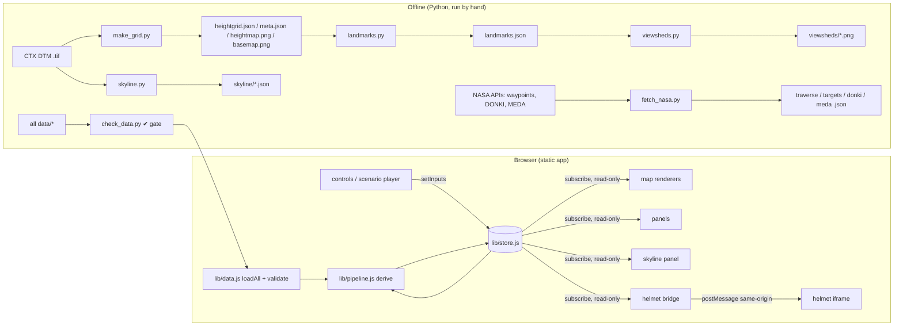

# Sightline — full team context (paste this whole file into Claude)

> Generated bundle of every doc in the repo. Tell Claude which part is yours. Regenerate: `bash scripts/bundle.sh`

---

# FILE: `README.md`

# Sightline — the Mars map with no blue dot

**NASA Space Apps Challenge 2026 · Jakarta · Challenge: "Interplanetary Survival Guide: Martian Map" (Jezero Crater)**
Team: Brayden, Jojo, Sean, Edward

> **How to use this file with Claude:** paste `CONTEXT_BUNDLE.md` (everything in one file) into Claude, or open the repo in Claude Code — it reads `CLAUDE.md`. This README = concept, data formats, file layout, rules. **`ARCHITECTURE.md` = how the system fits together (state, pipeline, function signatures, failure handling, security).** Your feature README = the detailed build spec. Priority if they disagree: ARCHITECTURE.md → README.md → feature README. Tell the team.

---

## 1. The idea in one sentence

Mars has no GPS. **Sightline answers one question at every step of a spacewalk: "Can this astronaut still find their way home safely?"**

Every hazard feeds that one answer — dust, radiation, a body weakened by the trip, vision changes, the suit's clock. Not a pile of separate alerts: one **Walk Budget** and one map.

### The three parts

| Part | What it does | Folder |
|---|---|---|
| **SEE** | Map of where the astronaut **cannot see home or any landmark** ("blind zones"). On real Jezero terrain, home is hidden from ~75% of the ground within 3 km. Dust shrinks visibility → blind zones grow live. Routes that stay in sight. | `map/`, `route/`, `scripts/` |
| **LOCATE** | **Skyline Fix**: astronaut turns 360°, helmet camera skyline is matched against skylines computed from NASA elevation data → position estimate + uncertainty circle. No GPS needed. | `skyline/`, `scripts/` |
| **CREW** | Body + suit model on NASA numbers: radiation (Curiosity RAD + DONKI solar storms), weakness after landing, vision changes (SANS), suit time, suit cooling vs air pressure (MEDA), cold, dust devils, dust storms, body-clock drift → one **Walk Budget** with GREEN / AMBER / RED. | `crew/`, `data/` |
| **+ Helmet view** | 3D first-person view from the real terrain with an arrow/beacon to home and the walk budget as a HUD (AR concept for future helmets). | `helmet/` |

### Demo story (this is what the 30-second video shows)
EVA on sol 12 → a solar storm hits (replay of the real May 2024 event that Curiosity measured) → walk budget turns RED "shelter now" → dust optical depth rises → far landmarks disappear → blind zones grow on the map → route planner gives a new way home along close landmarks → astronaut does a 360° turn → Skyline Fix confirms position → helmet view shows the arrow home.

---

## 2. Hackathon rules that affect the build

- **Deadline: Sunday 15 Nov 2026, 23:59 WIB.** Feature freeze Sunday 16:00. First "Submit for Judging" Sunday 21:00.
- Judges know apps won't be finished: **show the blueprint + reasoning** for parts not built.
- Judging: **Impact, Creativity, Validity, Relevance, Presentation.** Validity = label every number as *NASA data* or *our estimate* (the `isEstimate` flag in `data/crew_constants.json`).
- Must use **at least one NASA resource listed in the challenge's Resources tab** (Sean confirms which).
- **Cite everything** (libraries too) → `data/sources.md`.
- **No NASA logos / meatball / mission patches** anywhere in the app or video.
- AI-generated images/video need a visible **"SI-generated"** watermark. AI-written code: keep the header comment `// Written with AI assistance (Claude / GitHub Copilot)` at the top of each file.
- All text in **English**. No person under 18 in any media.
- Everything must work from a **public static link** (GitHub Pages). **No backend server.** Heavy maths is precomputed in Python (`scripts/`) and saved as files in `data/`.

---

## 3. Tech stack (no build step)

- Plain **HTML + CSS + JavaScript ES modules** (`<script type="module">`). No npm, no bundler, no framework. Open with any static server.
- **Leaflet 1.9.4** (2D map): `https://cdnjs.cloudflare.com/ajax/libs/leaflet/1.9.4/leaflet.js` + `.css`
- **A-Frame 1.6.0** (3D helmet view): `https://aframe.io/releases/1.6.0/aframe.min.js`
- **Python 3** (`scripts/`): numpy, Pillow, (optional) rasterio. Outputs JSON/PNG into `data/`.
- Hosting: **GitHub Pages** from `main` branch root.

Run locally from the repo root:
```bash
python3 -m http.server 8000
```
Then open http://localhost:8000 (main app) and http://localhost:8000/helmet/ (helmet view).

---

## 4. Repo layout and owners

```
/README.md            this file (everyone)
/CLAUDE.md            short rules for Claude Code
/SUBMISSION.md        video script, project page text, final checklist (Brayden + Sean)
/index.html           main app entry (Brayden)
/styles.css           main app styles (Brayden)
/lib/geo.js           shared coordinate helpers (Brayden, first hour)
/lib/store.js         shared app state (Brayden, first hour)
/map/                 2D map, blind zones, panels, scenario player (Brayden)   → map/README.md
/route/               route planner (Jojo)                                   → route/README.md
/crew/                crew model + walk budget + alerts (Jojo)               → crew/README.md
/skyline/             Skyline Fix UI (Brayden + Sean)                        → skyline/README.md
/helmet/              A-Frame helmet view (Edward)                           → helmet/README.md
/scripts/             Python precompute (Brayden + Sean)                     → scripts/README.md
/data/                all data files + sources (Sean)                        → data/README.md
```

**Rule: only edit files in your own folder.** Need something from another folder? Ask in WhatsApp, or agree to change the contract in this README.

Until real data arrives, **every feature must run on mock data** that follows the contracts below — never block on a teammate.

---

## 5. Coordinates and the terrain grid (everyone must follow this)

- Area = the **CTX DTM of Jezero** (NASA/USGS Mars 2020 terrain relative navigation product, 20 m/pixel, 1596 × 1512 px, equirectangular, Mars radius 3,396,190 m).
- Bounds: **lat 18.2110273909634 → 18.7211944818728 N, lon 77.1604654592237 → 77.6989751662947 E.**
- Elevations: −2710.7 m to −1515.5 m (relative to Mars areoid). Home elevation ≈ −2567 m.
- **Home / habitat** = the Perseverance landing site ("Octavia E. Butler Landing"): **lat 18.4447, lon 77.4508**.
- Working grid = DTM downsampled ×4 → **399 cols × 378 rows, 80 m per cell (projected)**.
  - Row 0 = north edge (latMax). Col 0 = west edge (lonMin). Row-major.
  - North–south ground metres per cell = 80. East–west ground metres per cell = 80 × cos(lat) ≈ 76 (the projection uses standard parallel 0°, so east–west must be multiplied by cos(lat)).

### `lib/geo.js` (Brayden writes this in the first hour — everyone imports it)
```js
// Written with AI assistance
export const R = 3396190;
export function deg2rad(d) { return d * Math.PI / 180; }
// meters between two lat/lon points (equirectangular approximation, fine at <50 km)
export function distM(lat1, lon1, lat2, lon2) {
  const x = deg2rad(lon2 - lon1) * Math.cos(deg2rad((lat1 + lat2) / 2)) * R;
  const y = deg2rad(lat2 - lat1) * R;
  return Math.hypot(x, y);
}
// bearing in degrees, 0 = north, 90 = east
export function bearingDeg(lat1, lon1, lat2, lon2) {
  const x = deg2rad(lon2 - lon1) * Math.cos(deg2rad((lat1 + lat2) / 2));
  const y = deg2rad(lat2 - lat1);
  return (Math.atan2(x, y) * 180 / Math.PI + 360) % 360;
}
// grid <-> lat/lon (grid = data/heightgrid.json, bounds = meta.bounds)
export function toCell(grid, b, lat, lon) {
  return { r: Math.floor((b.latMax - lat) / (b.latMax - b.latMin) * grid.h),
           c: Math.floor((lon - b.lonMin) / (b.lonMax - b.lonMin) * grid.w) };
}
export function toLatLon(grid, b, r, c) {
  return { lat: b.latMax - (r + 0.5) / grid.h * (b.latMax - b.latMin),
           lon: b.lonMin + (c + 0.5) / grid.w * (b.lonMax - b.lonMin) };
}
export function heightAt(grid, r, c) { return grid.data[r * grid.w + c]; }
```

---

## 6. Data contracts (file formats)

All files live in `data/`. Sean (and `scripts/`) produce them. Everyone else reads them. Mock versions are fine until the real ones land — **same shape**.

### `data/meta.json`
```json
{
  "bounds": { "latMin": 18.2110273909634, "latMax": 18.7211944818728,
              "lonMin": 77.1604654592237, "lonMax": 77.6989751662947 },
  "marsRadiusM": 3396190,
  "home": { "id": "home", "name": "Habitat (Octavia E. Butler Landing)", "lat": 18.4447, "lon": 77.4508, "heightM": 5 },
  "eyeHeightM": 1.7,
  "gridFile": "data/heightgrid.json"
}
```

### `data/heightgrid.json`
```json
{ "w": 399, "h": 378, "cellM": 80, "min": -2710.7, "max": -1515.5,
  "data": [ -2567.2, -2566.9, "... w*h numbers, metres, row-major, row 0 = north, 1 decimal" ] }
```

**No NaN / null allowed** — fill DTM no-data with the nearest valid value before writing (Python writes `NaN`, which is invalid JSON and kills the app).

### `data/basemap.png`
Hillshade image of the DTM (full working-grid extent, ≥ 1596 × 1512 px, grayscale). Drawn under the Mars Trek tiles as an offline fallback if the tile server is slow during judging.

### `data/heightmap.png`
Same grid as an 8-bit grayscale PNG (399 × 378). Pixel value v → elevation = min + v/255 × (max − min). For quick visuals only; use `heightgrid.json` for maths.

### `data/landmarks.json`
```json
[
  { "id": "home", "name": "Habitat", "lat": 18.4447, "lon": 77.4508, "heightM": 5, "kind": "habitat", "source": "Perseverance landing site" },
  { "id": "peak_01", "name": "Delta front butte", "lat": 18.47, "lon": 77.40, "heightM": 0, "kind": "peak", "source": "auto-picked from CTX DTM" }
]
```
`kind`: `habitat | peak | rim | beacon | science`. `heightM` = height of an object standing on the ground (0 for natural terrain).

### `data/viewsheds/<landmarkId>.png`
Grayscale PNG on the working grid (399 × 378): 255 = this landmark's top is visible from a standing astronaut's eyes (1.7 m) at that cell, 0 = hidden. Includes Mars curvature.

### `data/crew_constants.json`
Array of every number the crew model uses — **already filled in** with researched values:
```json
[{ "key": "surface_dose_msv_per_sol", "value": 0.67, "unit": "mSv/sol", "label": "...", "source": "...", "url": "...", "isEstimate": false, "note": "..." }]
```

### `data/targets.json` (science points, real Perseverance positions)
```json
[{ "id": "three_forks", "name": "Three Forks sample depot (approx.)", "lat": 18.4525, "lon": 77.4072, "sol": 648, "source": "M20_waypoints.json" }]
```

### `data/traverse.json` (real Perseverance path)
```json
[{ "sol": 13, "lat": 18.44463, "lon": 77.45089 }]
```

### `data/donki_sep_may2024.json`
Raw response of the NASA DONKI SEP API for May 2024 (see `data/README.md`).

### `data/scenario_demo.json` (the demo story timeline)
```json
{
  "name": "Sol 12 EVA — May 2024 storm replay",
  "sol": 12, "startLtst": 9.0, "start": { "lat": 18.4447, "lon": 77.4508 },
  "target": "three_forks",
  "events": [
    { "tMin": 0,   "type": "eva_start" },
    { "tMin": 60,  "type": "tau", "value": 0.5 },
    { "tMin": 120, "type": "sep_onset", "donkiId": "<id from donki file>", "note": "Replay of the May 2024 solar particle event" },
    { "tMin": 135, "type": "tau", "value": 2.0 },
    { "tMin": 150, "type": "skyline_fix", "site": "landing" },
    { "tMin": 200, "type": "eva_end" }
  ]
}
```

**Coordinate order everywhere in our files and functions: `[lat, lon]` or `{lat, lon}`.** GeoJSON's `[lon, lat]` is converted inside `scripts/fetch_nasa.py` only.

### `route.json` / route object (produced by `route/route.js`)
```json
{ "mode": "safest", "points": [[18.4447, 77.4508], [18.45, 77.44]], "lengthKm": 3.2,
  "maxSlopeDeg": 9.5, "blindFraction": 0.12, "etaMin": 74 }
```

### `data/skyline/<site>.json` (Skyline Fix results, produced by `scripts/skyline.py`)
See `skyline/README.md`.

---

## 7. Shared app state — see `ARCHITECTURE.md` §4–§5

Summary (the full contract, function signatures and rules live in ARCHITECTURE.md):
- `lib/store.js` holds `{ data, inputs, derived }`. **Only `setInputs(patch)` changes state**; it runs the pipeline and notifies subscribers once.
- `lib/pipeline.js` computes, in this fixed order: `computeLimits` → visibility → `planRoute` (home + target) → `computeBudget`.
- Renderers `subscribe()` and **only read**. Calling `setInputs` inside a subscriber throws.
- Main app ↔ helmet iframe: same-origin `postMessage` with a `hello` handshake and versioned messages (ARCHITECTURE §9).

---

## 8. NASA data used (for the "NASA Data" field)

| Dataset | Used for |
|---|---|
| HiRISE 25 cm orthomosaic of Jezero (Mars Trek WMTS) | Base map (close zoom) |
| CTX 6 m orthomosaic of Jezero (Mars Trek WMTS) | Base map (wide) |
| CTX 20 m DTM (Mars 2020 TRN product, USGS Astrogeology) | Terrain, slopes, viewsheds, Skyline Fix, 3D helmet terrain |
| Perseverance waypoints (`M20_waypoints.json`, mars.nasa.gov MMGIS) | Real traverse, science targets |
| Perseverance raw Navcam images (mars.nasa.gov raw images API) | Skyline Fix real-photo check (stretch) |
| Curiosity RAD (Hassler et al. 2014; May 2024 event) | Radiation dose rates |
| DONKI SEP API (api.nasa.gov) | Solar storm replay |
| Perseverance MEDA (PDS Atmospheres node) | Pressure, temperature |
| NASA Human Research Program / NTRS reports | Body, vision, suit numbers |

Tile URLs (Leaflet, `L.CRS.EPSG4326`, `{z}/{y}/{x}`):
- CTX: `https://trek.nasa.gov/tiles/Mars/EQ/JEZ_ctx_B_soc_008_orthoMosaic_6m_Eqc_latTs0_lon0/1.0.0/default/default028mm/{z}/{y}/{x}.png` — tiles exist up to zoom **13**
- HiRISE: `https://trek.nasa.gov/tiles/Mars/EQ/JEZ_hirise_soc_006_orthoMosaic_25cm_Eqc_latTs0_lon0_first_dd/1.0.0/default/default028mm/{z}/{y}/{x}.png` — tiles exist up to zoom **17**

---

## 9. Timeline

**Saturday 14 Nov**
- First hour: repo cloned by all, `lib/geo.js` + `lib/store.js` + empty `index.html` pushed (Brayden); all 4 registered on the Space Apps project page.
- Sean → `meta.json`, `heightgrid.json`, `heightmap.png` **first** (Edward and Jojo need them).
- 23:59 checkpoint: every part shows *something* on the one page, even ugly.

**Sunday 15 Nov**
- Morning: wire the demo story (scenario player), Skyline Fix panel, alerts, helmet linked.
- 16:00 **feature freeze** → deploy, test in incognito, record video.
- 21:00 first Submit for Judging → fixes → final re-submit by 23:00.

## 10. Git workflow (keep it simple)

```bash
git pull                      # before you start, every time
git add <your files>
git commit -m "feat(crew): walk budget v1"
git push
```
Commit at least every hour. If `git push` fails: `git pull --rebase` then push again. Never force-push. Big raw files (`.tif`, `.zip`) go to the shared Google Drive, not git (see `.gitignore`).

---

# FILE: `ARCHITECTURE.md`

# Sightline — System Architecture

**Read this after `README.md`. If a feature README disagrees with this file, this file wins.**
Owner: Brayden (changes go through the team chat first).

---

## 1. Design principles (the rules everything else follows)

1. **Offline-first, static only.** The judged app is plain files on GitHub Pages. **Zero runtime calls to our own servers or to NASA APIs.** All NASA data is fetched and processed **once, offline, by Python**, then committed to `data/`. Runtime external dependencies are only: Mars Trek map tiles + 2 pinned CDN libraries + Google Fonts — and each has a fallback (section 8).
2. **One-way data flow.** UI and the demo player change **inputs**. One pipeline turns inputs into **derived** results. Renderers only read. Nothing that renders is allowed to write state.
3. **Pure maths, isolated side effects.** `computeLimits`, `computeBudget`, `planRoute`, `stateAt` are pure functions (same input → same output, no DOM, no fetch). They can be tested on their own and shared with the helmet view.
4. **Validate at every boundary.** Every file is checked when loaded. Bad or missing data fails **loudly** on screen — never silently.
5. **Truth labels everywhere.** Every science number comes from `data/crew_constants.json` with `isEstimate`. Every mock file shows a visible **MOCK DATA** badge. Nothing can pass as NASA data by accident.
6. **Deterministic demo.** The scenario is a pure function of time `t`. Scrubbing back and forth always gives the same screen — the 30-second video is reproducible.

---

## 2. System overview



---

## 3. Components and ownership

| Layer | Module | Owner | Kind | Responsibility |
|---|---|---|---|---|
| Offline | `scripts/*.py` | Sean, Brayden | batch | Produce every file in `data/` |
| Offline | `scripts/check_data.py` | Brayden | gate | Validate every contract in `data/` (must pass before submitting) |
| Core | `lib/geo.js` | Brayden | pure | Coordinates, distance, bearing, grid ↔ lat/lon |
| Core | `lib/store.js` | Brayden | state | Holds `{inputs, derived, data}`; the only place state lives |
| Core | `lib/data.js` | Brayden | I/O | Load + validate all `data/` files (real → mock fallback, records which) |
| Core | `lib/pipeline.js` | Brayden | orchestrator | Runs derive steps in fixed order; caches expensive steps |
| Model | `crew/budget.js` | Jojo | pure | `computeLimits`, `computeBudget` |
| Model | `route/route.js` | Jojo | pure | `planRoute` (A*) |
| Model | `map/visibility.js` | Brayden | pure + cache | `visibilityArrays(visKm)` from viewshed PNGs |
| Model | `map/scenario.js` | Brayden | pure | `stateAt(t)` → inputs for the demo |
| View | `map/map.js`, `map/panels.js` | Brayden | render | Leaflet layers, budget card, alerts, controls, sources modal |
| View | `skyline/skyline.js` | Brayden + Sean | render | Skyline Fix panel (reads precomputed results) |
| View | `helmet/*` | Edward | render | 3D view in an iframe, receives state by message |

**Rule:** only the owner edits a module. Everyone else uses its exported functions exactly as written in section 5.

---

## 4. State model

```js
store = {
  data:    { meta, grid, landmarks, targets, traverse, constants, scenario, skyline, viewsheds, status },  // loaded once, read-only
  inputs:  { ... },   // written ONLY by setInputs() (controls, scenario player, skyline fix)
  derived: { ... }    // written ONLY by lib/pipeline.js
}
```

### `inputs` (everything a user or the scenario can change)
| Field | Type / unit | Notes |
|---|---|---|
| `sol` | integer ≥ 0 | sols since landing |
| `ltst` | hours 0–24 (Mars local true solar time) | |
| `evaMin` | **Earth** minutes since EVA start | Mars hour = 61.65 Earth min |
| `astronaut` | `{lat, lon, headingDeg}` | the position the crew **believes** (best estimate) |
| `distSinceFixM` | metres walked since the last position fix | drives uncertainty growth |
| `fixUncertaintyM` | metres | uncertainty right after the last fix (30 m at home, Skyline Fix result later) |
| `tau` | dust optical depth, 0.1–10 | |
| `sepActive` | boolean | solar particle event |
| `pressurePa`, `tempC` | Pa, °C | |
| `sansAffected` | boolean | |
| `routeMode` | `'shortest' \| 'safest' \| 'homeInSight'` | |
| `target` | `{lat, lon, id?} \| null` | where the crew is heading (null = home) |
| `scenarioT` | Earth minutes \| null | null = free mode (sliders) |

### `derived` (computed, never set by hand)
| Field | From |
|---|---|
| `limits` = `{speedKmh, maxSlopeDeg, visibilityKm}` | `computeLimits(inputs, C)` |
| `posUncertaintyM` | `fixUncertaintyM + C.dead_reckoning_drift_pct/100 × distSinceFixM` |
| `vis` = `{blind, homeHidden, w, h, homeVisiblePct3km}` | `visibilityArrays(limits.visibilityKm)` |
| `routeOut` | `planRoute(... astronaut → target ...)` (null if no target) |
| `routeHome` | `planRoute(... astronaut → home, mode = inputs.routeMode ...)` (the scenario's return leg always uses `'safest'`) |
| `routeHomeKm` | remaining length of `routeHome` from the astronaut |
| `budget` | `computeBudget(inputs, limits, routeHomeKm, C)` |
| `warnings` | data/mocks/validation problems to show on screen |

---

## 5. The pipeline (fixes the route ↔ budget circular dependency)

The walk budget needs the length of the route home; the route planner needs the slope limit and speed. That was a circle. It is broken by splitting the crew model into **limits** (no route needed) and **budget** (needs route):

```
setInputs(patch)
  └─► pipeline.derive(inputs, data, prevDerived)          // synchronous, fixed order
        1. limits   = computeLimits(inputs, C)                      [crew/budget.js]
        2. posUncertaintyM                                          [pipeline]
        3. vis      = visibilityArrays(round(limits.visibilityKm))  [map/visibility.js]  cached by key
        4. routeHome, routeOut = planRoute(...)                     [route/route.js]     cached by key
        5. routeHomeKm = remaining length along routeHome            [lib/geo.js]
        6. budget   = computeBudget(inputs, limits, routeHomeKm, C) [crew/budget.js]
  └─► store.derived = result  →  notify subscribers ONCE
```

### Function signatures (binding contracts)
```js
// crew/budget.js
export function computeLimits(inputs, C)                       // → { speedKmh, maxSlopeDeg, visibilityKm }
export function computeBudget(inputs, limits, routeHomeKm, C)  // → budget object (crew/README.md "Output")

// route/route.js
export function planRoute(grid, bounds, vis, start, goal, opts) // opts = { mode, maxSlopeDeg, speedKmh, maxExpansions = 400000 }
                                                                 // → route object (README section 6), never throws: { ok:false, reason } on failure

// map/visibility.js
export function initVisibility(viewsheds, landmarks, grid, bounds) // once, after data load
export function visibilityArrays(visKm)                            // → { blind: Uint8Array, homeHidden: Uint8Array, w, h, homeVisiblePct3km }

// map/scenario.js
export function stateAt(scenario, t, data)                     // → inputs patch for time t (pure, deterministic)

// lib/pipeline.js
export function derive(inputs, data, prev)                     // → derived
```

### Caching rules (keep it fast)
- **Visibility** recomputes only when `round(visibilityKm)` changes (≤ ~150 values) — cache by that key.
- **Routes** are replanned only when the **route key** changes:
  `mode | target | maxSlopeDeg | round(visibilityKm) | sepActive | floor(evaMin / 10) | astronaut rounded to 0.001° (~100 m)`.
  Small movements do **not** replan; between replans `routeHomeKm` = remaining length along the cached route + distance from the astronaut to the nearest route point.
- Budgets: A* ≤ 400k expansions (≈ < 300 ms); visibility ≤ 50 ms; one full `derive` ≤ 16 ms when caches hit.

### Store rules (prevents infinite loops)
```js
export function setInputs(patch)   // validates + merges into a NEW inputs object, runs derive, notifies once
export function subscribe(fn)      // fn(store) — read-only
export function getStore()         // returns the current frozen snapshot
```
- State objects are **replaced, never mutated** (`inputs = {...inputs, ...patch}`); snapshots are `Object.freeze`d.
- Calling `setInputs` **while subscribers are being notified throws** an error ("renderers must not write state"). Renderers that need to react (e.g. auto-open Skyline Fix) do it through a user action or the scenario, not inside a subscriber.
- `setInputs` rejects unknown keys and out-of-range values (`tau` 0.1–10, `ltst` 0–24, `sol` 0–1000, lat/lon inside `meta.bounds`) — it clamps numbers and logs a warning.

---

## 6. The demo scenario (deterministic)

- `scenario_demo.json` events are applied in order of `tMin` (ties: file order).
- `stateAt(scenario, t, data)` builds the inputs **from scratch for any `t`**: start state → apply every event with `tMin ≤ t` → place the astronaut along the planned legs.
- Legs are planned **once** and cached: outbound leg at `t = 0` (start → target); at `sep_onset` a return leg from the position at that moment → home (mode `safest`). Same inputs → same legs → same video every time.
- Movement speed along a leg = `computeLimits(...).speedKmh` at that time.
- `distSinceFixM` grows with distance walked; a `skyline_fix` event sets `fixUncertaintyM = skyline.uncertaintyM` and `distSinceFixM = 0`.
- Player clock: 1 real second = 2 EVA minutes (configurable), `requestAnimationFrame`, paused when the tab is hidden.

---

## 7. Data layer

### Loading (`lib/data.js`)
For each file: try `data/<file>` → if 404/invalid, try the mock (`map/mock/<file>.mock.json` or the module's own mock) → record `status[file] = 'real' | 'mock' | 'missing'`.
**Any `mock` or `missing` → a fixed "MOCK DATA: …" badge on screen.** The submission checklist requires zero mocks.

### Validation (browser `lib/data.js` and offline `scripts/check_data.py` check the same rules)
| File | Must hold |
|---|---|
| `meta.json` | bounds as in README; `home` inside bounds |
| `heightgrid.json` | `data.length === w*h`; **every value a finite number** (no NaN/null — Python must fill no-data before `json.dump`, because `NaN` is not valid JSON); `min ≤ value ≤ max` |
| `viewsheds/<id>.png` | one per landmark id; **exactly `w × h` of the grid**; values only 0/255 |
| `landmarks.json` | unique ids; `home` present; all inside bounds |
| `targets.json`, `traverse.json` | inside bounds; `traverse` sorted by sol |
| `crew_constants.json` | unique keys; **all keys the model needs exist** (list in `crew/README.md`); every `isEstimate:false` row has a non-empty, non-TODO `url` |
| `scenario_demo.json` | events sorted; `target` exists in `targets.json`; `skyline_fix.site` exists in `data/skyline/` |
| `skyline/<site>.json` | `observed.length === best.length === 360/azStepDeg`; `grid.rmsDeg.length === n*n` |

### Coordinate and unit conventions (one way only)
- Points in our files and functions: **`[lat, lon]`** arrays or `{lat, lon}` objects. GeoJSON's `[lon, lat]` order is converted **inside `fetch_nasa.py`** and never leaves it.
- Distances in **metres** internally; km only in UI text. Angles in **degrees**, azimuth 0 = north, clockwise.
- Time: `evaMin`, `tMin` = Earth minutes; `ltst` = Mars hours; `sol` = Mars days.
- Grid row 0 = north, col 0 = west; east–west metres × cos(lat).

---

## 8. Failure modes and fallbacks

| What fails | What the user sees | Mitigation |
|---|---|---|
| Mars Trek tiles slow/down during judging | Map still shows terrain | `data/basemap.png` (hillshade from the DTM, made by `make_grid.py`) is drawn under the tiles as an `L.imageOverlay` |
| A data file missing/invalid | MOCK DATA badge + warning list | loader fallback + validation messages |
| Route impossible (slopes) | "No safe route: all paths exceed 10° slope limit (sol 3 crew)" | `planRoute` returns `{ok:false, reason}` — it is a safety message, not an error |
| A* too slow | Route = last good route + note | `maxExpansions` cap |
| Helmet iframe not built yet / errors | Map app unaffected | iframe isolation; bridge ignores send failures |
| CDN (Leaflet/A-Frame) fails | Error card "Map library failed to load — reload" | pinned versions; `window.L` check at boot |
| JS exception in one renderer | Others keep working | each subscriber wrapped in `try/catch`, error shown in warnings |
| Browser without WebGL | Helmet button disabled with a note | feature check before opening |

---

## 9. Security and integrity

- **No secrets in the repo or the browser.** No API keys at runtime (all API data pre-fetched). DEMO_KEY used only offline. `check_data.py` greps `data/` for `api_key=` values other than `DEMO_KEY`.
- **postMessage is same-origin only.** Parent sends `iframe.contentWindow.postMessage(msg, location.origin)`. Helmet accepts a message only if `e.origin === location.origin && e.source === window.parent && msg.type` is one of the known types.
- **Message protocol (versioned):**
  - helmet → parent: `{ type: 'sightline:hello', v: 1 }` when ready
  - parent → helmet: `{ type: 'sightline:state', v: 1, inputs, derived: { limits, budget, routeHome, posUncertaintyM } }` (no big arrays — typed arrays are **not** sent)
  - parent replies to `hello` immediately with the current state, so the helmet never misses the first update.
- **No `innerHTML` with data.** All text from JSON is inserted with `textContent`. Source links are rendered only if they start with `https://`, with `rel="noopener noreferrer"`.
- **Pinned dependencies:** Leaflet 1.9.4 (cdnjs), A-Frame 1.6.0. No `@latest`.
- **Honest claims:** Skyline Fix results always carry their `method` text ("simulated skyline"). Budget factors always show NASA data / Estimate tags.

---

## 10. Loophole audit (what was wrong in the first specs and how it is closed)

| # | Loophole | Impact | Fix (where enforced) |
|---|---|---|---|
| 1 | `crew/wire.js` subscribed to the store and called `setState` inside the subscriber | infinite update loop / frozen tab | single pipeline (§5); `setInputs` throws during notify (`lib/store.js`) |
| 2 | Budget needs route length, route needs budget's slope/speed | circular dependency, undefined order | split into `computeLimits` → route → `computeBudget` (§5) |
| 3 | `Object.assign` mutated shared state | subscribers can't tell what changed; helmet gets half-updated objects | immutable snapshots, frozen (§5) |
| 4 | Route replanned on every change, incl. every movement tick | A* running 10×/s, lag | route key cache + 10-min refresh (§5) |
| 5 | `postMessage(..., '*')`, no origin check | any page could inject fake state into the helmet | same-origin + source + type checks (§9) |
| 6 | Helmet could load after the first state message | empty HUD | `hello` handshake (§9) |
| 7 | Python `json.dump` writes `NaN` for no-data | `JSON.parse` fails → app dead | fill no-data; validator (§7) |
| 8 | Viewshed PNG size could differ from the grid | wrong cells marked blind | size check in validator + loader (§7) |
| 9 | Mock fallback was silent | mock data could appear in the judged demo as NASA data | MOCK DATA badge + zero-mock gate (§7) |
| 10 | Mixed `[lon,lat]` (GeoJSON) and `[lat,lon]` (Leaflet) | points in the wrong place | one convention, converted only in `fetch_nasa.py` (§7) |
| 11 | Earth minutes vs Mars hours mixed | wrong LTST → wrong dust-devil/cold alerts | units table (§7) |
| 12 | Astronaut shown as an exact point | contradicts "no GPS" | believed position + uncertainty that grows with distance, reset by Skyline Fix (§4, §6) |
| 13 | Demo built by accumulating ticks | scrubbing back breaks; video not reproducible | `stateAt(t)` pure (§6) |
| 14 | Runtime dependence on NASA APIs (DEMO_KEY rate limits, CORS) | demo fails while judges watch | everything pre-fetched (§1) |
| 15 | Map tiles are an external dependency | blank map if Trek is down | local hillshade basemap (§8) |
| 16 | Constants could be missing / sources TODO while marked NASA data | silent `undefined` maths; false claims | required-keys check + url rule (§7) |
| 17 | Data from JSON put into HTML | injection | `textContent` only, https-only links (§9) |

---

## 11. Build order (dependencies)

1. `lib/geo.js`, `lib/store.js`, `lib/data.js` (with mocks), `lib/pipeline.js` with **stub** `computeLimits`/`computeBudget`/`planRoute` → the app runs end to end on mocks.
2. In parallel: real `crew/budget.js` (Jojo), real `route/route.js` (Jojo), `make_grid.py` → `landmarks.py` → `viewsheds.py` (Sean/Brayden), helmet on mock grid (Edward).
3. Swap stubs for real modules (same signatures — nothing else changes).
4. `skyline.py` + Skyline panel; scenario polish.
5. `check_data.py` passes with zero mocks → freeze → video → submit.

---

# FILE: `CLAUDE.md`

# Rules for Claude working in this repo

1. Read `README.md` (concept, file formats), then `ARCHITECTURE.md` (state, pipeline, exact function signatures, failure handling, security), then the README of the folder you are working in. Priority if they disagree: ARCHITECTURE.md → README.md → folder README.
2. Only create/edit files inside the folder you were asked to work in (plus the files that folder's README says it owns). Do not change another folder's files, the function signatures in ARCHITECTURE.md §5, or the data contracts in README.md §6 — if one must change, stop and say so.
3. No build step: plain HTML/CSS/JS ES modules, Leaflet 1.9.4 and A-Frame 1.6.0 from CDN, Python 3 + numpy + Pillow for scripts. No npm, no frameworks, no backend server.
4. Never write state from a renderer/subscriber. Only `setInputs()` changes state; derived values come from `lib/pipeline.js`. Model functions (`computeLimits`, `computeBudget`, `planRoute`, `stateAt`) stay pure: no DOM, no fetch.
5. Never call NASA or other APIs at runtime — the app only reads files in `data/` (plus map tiles). Never put API keys in the repo.
6. If a data file from `data/` does not exist yet, use a mock with the exact same shape named `*.mock.json`, loaded only as a fallback through `lib/data.js`, which marks it so the UI shows a MOCK DATA badge. Never make mock data look real.
7. Every number shown to the user that comes from science must come from `data/crew_constants.json` (or another `data/` file) — never hard-code a magic number in UI code. Show whether it is NASA data or an estimate.
8. Insert text from data files with `textContent`, never `innerHTML`. Links only if they start with `https://`.
9. Coordinates are `[lat, lon]` / `{lat, lon}` everywhere; metres and degrees internally; `evaMin` = Earth minutes, `ltst` = Mars hours.
10. Start each new code file with: `// Written with AI assistance (Claude / GitHub Copilot)` (Python: `#`). Hackathon rules require declaring AI use.
11. No NASA logos, meatball, mission patches or NASA branding in UI or images. English only in UI text.
12. Keep it small and working. A demo that runs beats a big feature that doesn't.

---

# FILE: `map/README.md`

# Feature: Main app — 2D map, blind zones, panels, demo player

**Owner:** Brayden · **Also owns:** `/index.html`, `/styles.css`, `/lib/geo.js`, `/lib/store.js`
**Paste into Claude together with the root `README.md`.**

## Purpose
This is the screen judges see. It shows the Jezero map and the astronaut's position, and answers **"can this astronaut still get home?"** at a glance. It hosts every other feature: the walk budget panel (`crew/`), routes (`route/`), Skyline Fix (`skyline/`) and the helmet view (`helmet/`, in an iframe).

## Files to create
```
/index.html            page shell, loads Leaflet CSS/JS from cdnjs, <script type="module" src="map/app.js">
/styles.css            all main-app styles
/lib/geo.js            exactly as in root README section 5
/lib/store.js          setInputs / subscribe / getStore (ARCHITECTURE.md §5 store rules)
/lib/data.js           loadAll(): real file → mock fallback, validation, status per file (ARCHITECTURE.md §7)
/lib/pipeline.js       derive(inputs, data, prev): limits → visibility → routes → budget, with caches (§5)
/map/stubs.js          temporary computeLimits / computeBudget / planRoute with the real signatures, used until crew/ and route/ land
/map/app.js            boot: loadAll → initVisibility → first setInputs → mount renderers (subscribers, read-only)
/map/map.js            Leaflet map, base layers, markers, route + traverse lines, uncertainty circle
/map/visibility.js     blind-zone overlay (combine viewshed PNGs, dust visibility cut-off)
/map/panels.js         walk budget panel, alert list, sources/"how we know" modal, controls
/map/scenario.js       demo player: plays data/scenario_demo.json on a timeline
```

## First hour (unblocks everyone)
1. `lib/geo.js`, `lib/store.js`, `lib/data.js`, `lib/pipeline.js`, `map/stubs.js` → app runs end to end on mocks (ARCHITECTURE.md §11).
2. `index.html` with the map and the right-side panel.
3. Push. Tell the group.

## Layout
- Desktop (≥ 1024 px): map fills the left ~68%; right column = **Walk Budget card** (big status + minutes left), **Alerts** list, **Controls**. A collapsible bottom strip = **scenario timeline** (play/pause, scrub, current sol / LTST / EVA minutes).
- Mobile (≤ 768 px): map on top (60vh), panels stacked below. No horizontal scroll.
- A "Helmet view" button opens `helmet/index.html` in an iframe overlay (full-screen modal with close button). The helmet bridge answers `sightline:hello` and sends `sightline:state` on every change, same-origin only (ARCHITECTURE.md §9).
- Visual direction: mission-control dark UI over the orbital imagery. Status colours: GREEN `#3fb950`, AMBER `#d29922`, RED `#f85149`. Monospace for numbers (e.g. "IBM Plex Mono" or "JetBrains Mono" from Google Fonts), clean sans for text. Avoid generic template look: no gradient blobs, no tiny label text above every heading, no "01 ·" numbering.

## Map (map/map.js)
```js
const map = L.map('map', { crs: L.CRS.EPSG4326, minZoom: 9, maxZoom: 18, maxBounds: [[18.20, 77.15], [18.73, 77.71]] })
  .setView([18.4447, 77.4508], 13);
const ctx = L.tileLayer('https://trek.nasa.gov/tiles/Mars/EQ/JEZ_ctx_B_soc_008_orthoMosaic_6m_Eqc_latTs0_lon0/1.0.0/default/default028mm/{z}/{y}/{x}.png',
  { maxNativeZoom: 13, maxZoom: 18, attribution: 'CTX mosaic: NASA/JPL-Caltech/MSSS, via NASA Mars Trek' }).addTo(map);
const hirise = L.tileLayer('https://trek.nasa.gov/tiles/Mars/EQ/JEZ_hirise_soc_006_orthoMosaic_25cm_Eqc_latTs0_lon0_first_dd/1.0.0/default/default028mm/{z}/{y}/{x}.png',
  { maxNativeZoom: 17, maxZoom: 18, minZoom: 13, attribution: 'HiRISE mosaic: NASA/JPL-Caltech/UArizona, via NASA Mars Trek' }).addTo(map);
```
(Tile availability verified: CTX up to z13, HiRISE up to z17. HiRISE covers only part of the area — CTX stays underneath.)

Layers (use `L.control.layers` to toggle):
- **Home** marker (habitat icon) + **landmarks** (small triangles, label on hover) from `data/landmarks.json`.
- **Science targets** from `data/targets.json`.
- **Perseverance traverse** (thin white line) from `data/traverse.json` — label "Real Perseverance route (NASA)". It shows our terrain is real and drivable.
- **Astronaut** marker with a heading wedge, and an **uncertainty circle** (`L.circle`, radius = `derived.posUncertaintyM`, which grows with distance walked since the last fix). Never draw a precise "blue dot" — the circle is the point of the app.
- **Route** polyline(s) from `route/route.js` — `safest` solid, `shortest` dashed.
- **Blind zones** overlay (below).
- Click on map → in "Plan" mode, sets the route target and calls `planRoute` (see `route/README.md`).

## Blind zones (map/visibility.js) — the SEE feature
Exports `initVisibility(viewsheds, landmarks, grid, bounds)` and `visibilityArrays(visKm)` (ARCHITECTURE.md §5), cached by `round(visKm)`. Viewshed PNG size must equal the grid size — throw at init otherwise.

A cell is **blind** if the astronaut standing there cannot see **any usable landmark** (home included).
A landmark L is usable from cell X when:
1. viewshed `data/viewsheds/<L.id>.png` is 255 at X, **and**
2. distance(X, L) ≤ effective visibility range `visKm` (from the walk budget output: `derived.limits.visibilityKm`, from `computeLimits` — dust τ and SANS vision, see `crew/README.md`).

Implementation:
```js
// load each viewshed PNG into an offscreen canvas once, keep Uint8 arrays
// on every state change of tau / sansAffected:
//   for each cell: blind = !landmarks.some(L => vis[L.id][i] && distM(cell, L) <= visKm*1000)
//   paint an ImageData (blind = rgba(248,81,73,0.35), home-visible = transparent, landmark-only = rgba(210,153,34,0.15))
//   L.imageOverlay(canvas.toDataURL(), [[latMin, lonMin], [latMax, lonMax]], { opacity: 1 })
```
- Precompute each cell's lat/lon once with `toLatLon`.
- 399 × 378 × ~15 landmarks = ~2M checks: fast enough. Only recompute when `tau`, `sansAffected` or the landmarks change, not every tick.
- Legend: red = "No landmark in sight", amber = "Home hidden, landmark visible", clear = "Home in sight".
- Show the stat line: "Home visible from X% of ground within 3 km" (computed from the same arrays).

## Panels (map/panels.js)
- **Walk Budget card** (from `derived.budget`, see `crew/README.md`): big status word (GO / CAUTION / RETURN NOW), minutes of suit time left, minutes needed to walk home (with 20% margin), "turn-back in X min", visibility km.
- **Alerts list**: `budget.factors` sorted RED → AMBER → GREEN. Each row: icon, message, and a small "NASA data" or "Estimate" tag. Clicking a row opens the sources modal at that constant.
- **Controls** (for judges to play): sol since landing slider (0–60), LTST slider (6–19), dust τ slider (0.2–5), "Solar storm" toggle, "Vision changes (SANS)" toggle, route mode (shortest / safest / keep home in sight).
- **"How we know" modal**: table of every row in `data/crew_constants.json` — label, value, unit, NASA data / estimate, source link. This is our Validity proof — make it look good.
- **Skyline Fix** button → opens the panel from `skyline/`.

## Demo player (map/scenario.js)
Plays `data/scenario_demo.json` using the deterministic `stateAt(scenario, t, data)` (ARCHITECTURE.md §6) — the player only sets `scenarioT`; positions/events are rebuilt from `t`, so scrubbing works both ways:
- Clock: 1 real second = 2 EVA minutes (configurable). Play / pause / scrub / restart.
- Moves the astronaut along `state.route.points` at the walk speed from the budget.
- Event effects (inside `stateAt`): `tau` → `tau`; `sep_onset` → `sepActive: true` and show a full-width red banner "Solar particle event — replay of May 2024 storm measured by Curiosity. Return to shelter."; `skyline_fix` → open Skyline Fix panel with that site's result; `eva_end` → stop.
- On `sep_onset` the return leg (position at that moment → home, mode `safest`) is planned once and cached, so the new route home appears.
- Each frame: `setInputs(stateAt(scenario, t, data))` → includes `evaMin = t`, `ltst = startLtst + t / 61.65` (one Mars "hour" = 61.65 Earth minutes), `astronaut`, `distSinceFixM`. The pipeline re-derives the budget — nothing subscribes and writes back.
- A "Video mode" key (`v`) hides controls for clean screen recording.

## Acceptance checklist
- [ ] Map loads CTX + HiRISE tiles at Jezero, EPSG4326, no console errors; `data/basemap.png` underneath as offline fallback.
- [ ] MOCK DATA badge visible whenever any mock is loaded.
- [ ] No renderer writes state; scrubbing the timeline backwards gives the same screen as forwards.
- [ ] Home, landmarks, targets, real Perseverance traverse visible.
- [ ] Blind-zone overlay grows when τ slider goes up; stat line updates.
- [ ] Walk Budget card + alerts update live from the sliders.
- [ ] Demo player runs the whole story start to end without touching anything.
- [ ] Helmet iframe opens and receives state.
- [ ] Works at 375 px and 1440 px wide, keyboard focus visible on all controls.
- [ ] Works on GitHub Pages (relative paths only, e.g. `data/meta.json` not `/data/meta.json`).

## Stretch (only after the checklist)
- "Where to put a beacon": click to place a 10 m beacon mast; show how many blind cells it would fix (needs a viewshed computed on the fly in a Web Worker, or precompute candidates in `scripts/`).
- Sun direction / shadows from LTST.

---

# FILE: `crew/README.md`

# Feature: CREW — crew condition model + Walk Budget + alerts

**Owner:** Jojo · **Paste into Claude together with the root `README.md`.**

## Purpose
Turn everything that can hurt an astronaut on a Mars walk into **one answer**: *can they still get home safely, and how much margin is left?* Output = a **Walk Budget** (status + minutes + a list of reasons with sources). The map panel, the alerts, the route planner and the helmet HUD all read this one object.

This is the "very complex, very detailed, one simple purpose" part. Every factor must be traceable to a row in `data/crew_constants.json` with `isEstimate` true/false — that is how we win **Validity**.

## Files to create
```
/crew/budget.js        export function computeLimits(inputs, C) and computeBudget(inputs, limits, routeHomeKm, C) — pure, no DOM, no fetch
/crew/budget.test.html open in browser: runs console.assert checks with fixed inputs, shows PASS/FAIL list
```
**No wiring file.** `lib/pipeline.js` (Brayden) calls your two functions in this order (ARCHITECTURE.md §5):
`computeLimits` → visibility → route planner → `computeBudget`. This order breaks the circle "budget needs route length / route needs budget's slope limit". **Never subscribe to the store or call `setInputs` from crew code.**

`C` = constants keyed by `key`: build it with
`const C = Object.fromEntries(rows.map(r => [r.key, r.value]))` (the pipeline passes it in; keep `rows` around only for the UI tags).

## `computeLimits(inputs, C)` → `{ speedKmh, maxSlopeDeg, visibilityKm }`
Needs no route. Implements factor 1 (speed + slope limit, flat-ground speed — no slope factor here) and factor 4 (visibility). The route planner and the blind-zone map use this.

## `computeBudget(inputs, limits, routeHomeKm, C)` → budget object
`inputs` = the store inputs (ARCHITECTURE.md §4): `sol, ltst, evaMin, tau, sepActive, pressurePa, tempC, sansAffected, ...`.
`routeHomeKm` = remaining length of the route home, given by the pipeline (it already includes slope effects through the route's travel time; if the route failed, the pipeline passes straight-line × 1.3 and adds a warning).
`limits` = output of `computeLimits` (copy its fields into the budget output).

### Required constant keys
`computeLimits`/`computeBudget` must throw a clear error at load if any key is missing (the loader checks this list too):
`walk_speed_kmh, walkback_pad, arrival_speed_factor_sol0, sensorimotor_recovery_days, max_slope_early_deg, max_slope_deg, eva_design_hours, eva_reserve_min, cruise_dose_msv_per_day, transit_days, surface_dose_msv_per_sol, career_limit_msv, may2024_sep_dose_ugy, terrain_shielding_pct, vis_dust_scale_height_km, sans_range_factor, tau_amber, tau_red, tau_jan2022_storm, dust_devil_peak_start_ltst, dust_devil_peak_end_ltst, dust_devil_max_wind_ms, mars_wind_earth_equiv_ms, sublimator_max_pressure_pa, cold_amber_c, cold_return_ltst, sans_diopter_shift, sol_drift_min, bone_loss_pct_per_month, perchlorate_pct`

Export it: `export const REQUIRED_KEYS = [...]`.

## Output
```js
{
  status: 'GREEN' | 'AMBER' | 'RED',
  headline: 'GO' | 'CAUTION' | 'RETURN NOW',
  suitMinLeft: 265,          // usable suit time left (after reserve)
  returnMin: 62,             // minutes needed to walk home incl. safety pad
  marginMin: 203,            // suitMinLeft - returnMin
  turnBackInMin: 203,        // same as margin, floored at 0
  extraOutKm: 3.1,           // how much further they could walk out and still come back
  speedKmh: 2.6,             // walking speed used
  maxSlopeDeg: 10,           // max allowed slope today (route planner reads this)
  visibilityKm: 117,         // usable landmark range (map blind zones read this)
  doseTodayMsv: 0.4,
  cumulativeMsv: 339,        // transit + surface so far
  careerPct: 56.5,           // cumulative / career limit
  factors: [                 // one per factor, worst first
    { id: 'suit_time', level: 'GREEN', label: 'Suit time', message: '265 min usable, home is 62 min away', keys: ['eva_design_hours', 'eva_reserve_min'] }
  ]
}
```
`keys` = which constants back this factor, so the UI can show "NASA data" vs "Estimate" and link sources.

## The model — factor by factor
All numbers come from `C` (crew_constants.json). Names below are the `key`s.

### 1. Walking speed (base for everything)
- `speed = walk_speed_kmh` (3.3 km/h, Apollo walk-back planning number — estimate for Mars).
- **Arrival weakness:** sensorimotor problems last about `sensorimotor_recovery_days` (7). Factor ramps linearly from `arrival_speed_factor_sol0` (0.6, estimate) on sol 0 to 1.0 on sol 7.
- **Slope:** not applied here — the route planner applies the Tobler hiking factor per step, so the route length/time already carries it. `computeBudget` uses `routeHomeKm` at the flat speed (keep it simple; note it in the factor message).
- `maxSlopeDeg` = `max_slope_early_deg` (10) before sol 7, else `max_slope_deg` (15). Both estimates. Route planner forbids steeper cells.

### 2. Suit time (the hard clock)
- `suitMinLeft = eva_design_hours*60 − evaMin − eva_reserve_min`
- `returnMin = routeHomeKm / speed * 60 * walkback_pad` (pad 1.2 = +20% like Apollo walk-back rule).
- `marginMin = suitMinLeft − returnMin`.
- RED if margin ≤ 0. AMBER if margin < 30. Else GREEN.
- `extraOutKm = max(0, marginMin) / 60 * speed / 2 / walkback_pad`.
- Message example: "Turn back in 41 min — home is 62 min away at today's pace."

### 3. Radiation
- `cumulativeMsv = cruise_dose_msv_per_day * transit_days + surface_dose_msv_per_sol * sol + todays EVA share`.
- `careerPct = cumulativeMsv / career_limit_msv * 100` (info, GREEN unless > 80%).
- **If `sepActive`** → RED, headline "RETURN NOW": "Solar particle event. Curiosity measured `may2024_sep_dose_ugy` µGy at Gale crater in the May 2024 event. Get to shelter: home is X min away." Shelter time = `returnMin`. Also add: "Terrain gives little cover (~`terrain_shielding_pct`% near a butte)."
- Note in UI: DONKI reports events seen near Earth; we use it as a **replay trigger** for the Mars event, not a live Mars forecast.

### 4. Dust storms → visibility (feeds blind zones)
- Horizontal visibility (Koschmieder): `visKm = 3.912 / (tau / vis_dust_scale_height_km)` (scale height 15 km = estimate: dust spread evenly through the lower atmosphere).
- If `sansAffected`: `visKm *= sans_range_factor` (0.8, estimate).
- Cap at 150 km (beyond the crater anyway).
- AMBER if tau > `tau_amber` (1.0); RED if tau > `tau_red` (3.0). Message: "Dust τ = 2.0 → landmarks beyond ~29 km lost. Blind zones growing."
- Context line: Jezero normal τ ≈ 0.3–0.5; the Jan 2022 regional storm pushed τ to ~1.7–2 (`tau_jan2022_storm`).

### 5. Dust devils
- If `ltst` within `dust_devil_peak_start_ltst`–`dust_devil_peak_end_ltst` (11–14 h) → AMBER: "Dust-devil peak hours (Perseverance saw >4 per sol, peak 12–13 h). Winds up to 32 m/s feel like a ~3.6 m/s breeze on Earth because the air is ~80× thinner — not a knock-down risk; risk is sudden zero visibility and dust on visor/joints. Keep a landmark in sight."

### 6. Suit cooling vs air pressure
- Suit water-sublimator cooling needs ambient pressure ≤ `sublimator_max_pressure_pa` (~933 Pa = 7 Torr).
- `marginPa = sublimator_max_pressure_pa − pressurePa`. RED if ≤ 0, AMBER if < 100, else GREEN with message "Cooling OK: 718 Pa vs 933 Pa limit (Perseverance MEDA)".

### 7. Cold
- AMBER if `tempC < cold_amber_c` (−70) or `ltst > cold_return_ltst` (16.5): "Air cools fast before dusk (Jezero swings ~50–60 °C per sol). Plan to be home by 17:00."

### 8. Vision (SANS)
- If `sansAffected`: AMBER info: "Spaceflight eye changes (+0.5 to +1.75 D far-sighted shift) make distant landmarks harder to recognise — landmark range reduced 20%." (keys `sans_diopter_shift`, `sans_range_factor`)

### 9. Body clock
- Info only: "Sol is 39.6 min longer than an Earth day → body clock drifts; after sol N the crew has shifted N×39.6 min." Level AMBER if `sol` ≥ 3 and ltst < 8 (early starts while drifting) — estimate rule.

### 10. Bone + fall risk (arrival)
- Info factor while sol < 30: "Bone loss in transit ~1–1.5% per month → avoid falls; max slope lowered to 10° until sol 7."

### 11. After the EVA (checklist, not a level)
- When `evaMin` reaches EVA end: show "Dust-off before entry: soil is ~0.5–1% perchlorate (thyroid risk)."

### Combining
- `status` = worst level of all factors. `headline`: GREEN → "GO", AMBER → "CAUTION", RED → "RETURN NOW".
- Sort `factors` RED → AMBER → GREEN.

## Tests (`budget.test.html`)
At least these, with `console.assert` and a visible PASS/FAIL list on the page:
1. Sol 30, evaMin 60, home 2 km, τ 0.4, no SEP, 718 Pa, −30 °C, ltst 10 → GREEN.
2. Same but `sepActive: true` → RED, headline "RETURN NOW".
3. evaMin 420, home 3 km → suit time RED (margin ≤ 0).
4. τ 2.0 → visibilityKm ≈ 29 (no SANS); with SANS ≈ 23.
5. Sol 0 → speed = 0.6 × base, maxSlopeDeg 10.
6. pressurePa 950 → cooling RED.

## Acceptance checklist
- [ ] `computeBudget` is pure, uses only `C` constants (no magic numbers), all tests pass.
- [ ] Map panel shows status, minutes, and factors with NASA/estimate tags.
- [ ] Turning the storm toggle flips to RED and the route planner re-plans home.
- [ ] τ slider changes `visibilityKm` and the blind zones grow.

## Stretch
- Dose-rate curve during the SEP replay using the DONKI event timing.
- Second crew member with different sol/SANS — budget for the pair = the worse of two.

---

# FILE: `route/README.md`

# Feature: Route planner — routes that keep you in sight of home

**Owner:** Jojo · **Paste into Claude together with the root `README.md`** (and `crew/README.md` if you need the budget fields).

## Purpose
Normal route planners find the shortest or flattest path. Ours also asks: **"if I get lost on this path, can I still see home or a landmark?"** It avoids blind zones and slopes the crew can't handle today, and gives the time home that the Walk Budget uses.

Three modes:
| Mode | Meaning |
|---|---|
| `shortest` | Least walking time, only forbids too-steep cells |
| `safest` | Walking time + penalty for cells where **no landmark** is visible |
| `homeInSight` | Big penalty for any cell where **home itself** is not visible |

## Files to create
```
/route/route.js        export function planRoute(grid, bounds, vis, start, goal, opts) → route object
/route/heap.js         tiny binary min-heap for A* (or inline in route.js)
/route/route.test.html browser test page with console.assert checks + PASS/FAIL list
```

## Inputs
- `grid` = `data/heightgrid.json` (399 × 378, 80 m cells; row 0 north). Use `lib/geo.js` helpers.
- `bounds` = `meta.bounds`.
- `vis` = `{ blind: Uint8Array(w*h), homeHidden: Uint8Array(w*h), w, h }` — 1 = blind / home hidden. From `visibilityArrays(visKm)` in `map/visibility.js` (the pipeline passes it in). Tests: build one with all zeros. **Assert `vis.w === grid.w && vis.h === grid.h`**, else return `{ok:false, reason:'visibility grid size mismatch'}`.
- `start`, `goal` = `{lat, lon}`.
- `opts` = `{ mode, maxSlopeDeg, speedKmh, maxExpansions = 400000 }` — `maxSlopeDeg` and `speedKmh` come from `computeLimits()` (crew), **not** from the budget (that would be circular — ARCHITECTURE.md §5).
- Signature is fixed: `planRoute(grid, bounds, vis, start, goal, opts)`. Pure function, **never throws** — any failure returns `{ ok:false, reason }`. Start/goal outside the grid → `{ok:false, reason:'outside map'}`. Start cell itself too steep/blocked → start from the nearest allowed cell.

## Algorithm (A* on the grid)
- Nodes = grid cells; 8 neighbours.
- Step ground distance: north–south 80 m, east–west 80 × cos(lat) m, diagonals = hypot of both.
- Slope of a step = atan(|Δheight| / distance) in degrees. If slope > `maxSlopeDeg` → step not allowed.
- Step time (minutes) = distance / (speedKmh × tobler(slope)) with `tobler(s) = exp(-3.5 * |tan(s_signed) + 0.05|) / exp(-0.175)` (s_signed: uphill positive).
- Step cost = step time × penalty:
  - `shortest`: penalty 1
  - `safest`: 1 + 3 × blind[next]
  - `homeInSight`: 1 + 3 × blind[next] + 6 × homeHidden[next]
- Heuristic = straight-line distance / speedKmh (admissible because penalties ≥ 1 and tobler ≤ ~1.0 on flat; if you allow tobler > 1 on gentle downhill, divide the heuristic by 1.2).
- Grid is 150k cells → A* runs in well under a second in the browser. If slow, stop searching after 400k node expansions and return "no route".
- After A*: simplify the path (drop points that are collinear within 1 cell) and convert to `[lat, lon]`.

## Output (route object — same shape as root README section 6)
```js
{ mode: 'safest', points: [[lat, lon], ...], lengthKm: 3.2, etaMin: 74,
  maxSlopeDeg: 9.5, blindFraction: 0.12, homeHiddenFraction: 0.40, ok: true, reason: null }
```
If no path: `{ ok: false, reason: 'All paths exceed 10° slope limit (sol 3 crew)' }` — show that reason in the UI, it's a useful safety message.

## How it's used
- Map click in Plan mode → `planRoute(start = astronaut, goal = clicked point)`. Draw `safest` solid and `shortest` dashed so judges see the trade-off ("+6 min, but home stays in sight 85% of the way").
- **When routes are re-planned is decided by `lib/pipeline.js`, not by route code** (route key: mode | target | maxSlope | visibility km | storm | every 10 EVA min — ARCHITECTURE.md §5). The pipeline turns `routeHome` into `routeHomeKm` for `computeBudget`. Route code never touches the store.
- Edward's helmet view walks along `points`.
- Save the demo route to `data/route_demo.json` (same shape) so the helmet view can use it standalone.

## Tests (`route.test.html`)
1. Flat mock grid, no blind cells: route length ≈ straight-line distance (±10%).
2. A wall of cells steeper than maxSlope across the middle with one gap → path goes through the gap.
3. `safest` avoids a blind block that `shortest` crosses.
4. Goal surrounded by steep cells → `ok: false` with a reason.

## Acceptance checklist
- [ ] Click → route drawn in < 1 s on the real grid.
- [ ] Two modes shown together with their minutes and % of route in sight.
- [ ] Storm / dust events re-plan the route home automatically.
- [ ] Route length feeds the Walk Budget.

## Stretch
- "Lost-recovery" mode: from the current uncertainty circle, route to the nearest cell where home is visible.
- Compare our route against the real Perseverance traverse (`data/traverse.json`) — % of the rover's path that keeps home in sight.

---

# FILE: `data/README.md`

# Feature: DATA — NASA data, science numbers, sources

**Owner:** Sean · **Paste into Claude together with the root `README.md`** (and `scripts/README.md` for the terrain scripts).

## Purpose
Everything in Sightline must stand on real NASA data. Sean owns the files in `data/` and the **sources list** — this is what makes the project pass **Validity** and qualify for global awards (≥ 1 NASA resource from the challenge Resources tab is required).

## Priority order (others are waiting on the first ones)
1. **Check the challenge Resources tab** on spaceappschallenge.org (Jezero / Martian Map challenge). Write down which listed NASA resources we use, word for word, in `data/sources.md` → section "Challenge resources used". Tell Brayden.
2. `meta.json`, `heightgrid.json`, `heightmap.png` → run `scripts/make_grid.py` (spec in `scripts/README.md`). **Send to Edward and Jojo as soon as done.**
3. `landmarks.json` → `scripts/landmarks.py`.
4. `traverse.json`, `targets.json`, `donki_sep_may2024.json` → `scripts/fetch_nasa.py` (below).
5. `scenario_demo.json` (below).
6. Verify `crew_constants.json` (already filled in) — fix any TODO sources.
7. `sources.md` complete for the submission page.
8. Stretch: MEDA pressure/temperature for one real sol.

## `scripts/fetch_nasa.py` (spec)

### Perseverance traverse + science targets
```
https://mars.nasa.gov/mmgis-maps/M20/Layers/json/M20_waypoints.json
```
GeoJSON, 708 features. `properties` has `sol, lat, lon, site, drive, dist_total_m, Note, images`.
- `data/traverse.json`: `[{sol, lat, lon}]` for every feature, sorted by sol.
- `data/targets.json`: rover position at these sols (pick the feature with the nearest sol):

| id | name | sol | approx lat, lon (checked in the waypoints file) |
|---|---|---|---|
| `landing` | Octavia E. Butler Landing | 13 (first waypoint) | 18.44463, 77.45089 |
| `three_forks` | Three Forks sample depot (approx., rover position during depot sols) | 648 | 18.45252, 77.40720 |
| `cheyava_falls` | Cheyava Falls / "Sapphire Canyon" sample area (approx.) | 1174 | 18.49500, 77.30628 |
| `delta_top` | Upper delta | 1320 | 18.46776, 77.29101 |
| `crater_rim` | Crater rim | 2022 | 18.43560, 77.23313 |

Mark them "approx." in names — they are rover positions near the feature, not survey points.

### DONKI solar particle events (May 2024)
```
https://api.nasa.gov/DONKI/SEP?startDate=2024-05-01&endDate=2024-05-31&api_key=DEMO_KEY
```
Save the raw JSON to `data/donki_sep_may2024.json` (14 events expected). Pick the event around **20 May 2024** (the big flare whose particles hit Mars) and put its `sepID` into `scenario_demo.json`. DEMO_KEY is rate-limited — fetch once, commit the file. (Get your own free key at api.nasa.gov if needed; never commit a personal key.)

Context for the UI: Curiosity's RAD measured **8,100 µGy** at Gale crater during that event (NASA/JPL, June 2024). DONKI events are observed near Earth — we use them as a **replay trigger**, and say so.

### Raw Navcam images (stretch, for Skyline Fix real-photo check)
```
https://mars.nasa.gov/rss/api/?feed=raw_images&category=mars2020&feedtype=json&num=50&search=NAVCAM_LEFT
```
Each image has `extended.mastAz`, `extended.mastEl`, `camera.camera_vector`, `image_files.full_res`. Panorama mosaics under `/mmgis-maps/M20/Layers/mosaics/` return 403 — use single Navcam frames instead.

## `data/scenario_demo.json`
Use the shape in root README section 6. Suggested timeline (sol 12 → crew still recovering, short slope limit — good drama):
- t=0 EVA start at home, LTST 9:00, target `three_forks` (~2.5 km WNW).
- t=60 τ 0.5. t=120 SEP onset (DONKI id). t=135 τ 2.0. t=150 Skyline Fix at site `landing` (or whichever skyline site exists). t=200 EVA end.
Brayden may tune the times for the video.

## `data/crew_constants.json` — already filled in
Every number the crew model uses, with `source`, `url`, `isEstimate`. Your job:
- Open each `url`, confirm the number. Fix or flag anything wrong.
- Rows with `"url": "TODO"` need a proper source found (search NTRS: ntrs.nasa.gov).
- **Never upgrade an estimate to NASA data without a source.**

## `data/sources.md` — the references list for the submission
Everything we used: NASA datasets (with URLs), papers, NASA reports, software libraries (Leaflet, A-Frame, numpy, Pillow), AI tools (Claude, GitHub Copilot), fonts. Hackathon rule: **cite everything, even open-source**. A starter version is already in the file.

## Stretch: MEDA (Perseverance weather station)
PDS Atmospheres node:
```
https://atmos.nmsu.edu/PDS/data/PDS4/Mars2020/mars2020_meda/data_derived_env/
```
Example pressure file (sol 1):
```
https://atmos.nmsu.edu/PDS/data/PDS4/Mars2020/mars2020_meda/data_derived_env/sol_0000_0089/sol_0001/WE__0001___________DER_PS__________________P02.CSV
```
Columns: `SCLK, LMST, LTST, PRESSURE, ...`. Browse the same sol folder for the air-temperature product (file name contains `ATS`) — verify the name before scripting. Output `data/meda_sol.json`: `[{ltst, pressurePa, tempC}]` for one sol → the demo player can use real pressure/temperature by time of day.

## Gate
Run `python3 scripts/check_data.py` after every data change. It checks every contract (ARCHITECTURE.md §7) and fails on missing files, NaN, wrong sizes, swapped lat/lon, duplicate ids, and constants marked NASA data without a source.

## Acceptance checklist
- [ ] Challenge Resources tab checked, used resources listed word for word.
- [ ] All files in root README section 6 exist with the right shape.
- [ ] `crew_constants.json` rows checked; TODOs resolved or clearly marked estimate.
- [ ] `sources.md` complete enough to paste into the submission page.

---

# FILE: `scripts/README.md`

# Feature: Python precompute scripts

**Owners:** Sean (terrain + data) and Brayden (viewsheds + Skyline Fix) · **Paste into Claude together with the root `README.md`.**

## Purpose
The website has no server, so all heavy maths runs **once, offline, in Python**, and the results are saved into `data/` as small JSON/PNG files the browser loads. Each script is run by hand: `python3 scripts/<name>.py`.

Setup (use Python 3.11–3.13):
```bash
python3 -m venv .venv && source .venv/bin/activate
pip install numpy pillow
```
Raw downloads go in `raw/` (git-ignored; share them via Google Drive).

## Input: the CTX DTM
Download (9.7 MB):
```bash
mkdir -p raw && curl -L -o raw/dtm.tif "https://asc-pds-services.s3.us-west-2.amazonaws.com/mosaic/mars2020_trn/CTX/JEZ_ctx_B_soc_008_DTM_MOLAtopography_DeltaGeoid_20m_Eqc_latTs0_lon0.tif"
```
- 1596 × 1512 float32, 20 m posting, equirectangular, standard parallel 0°, Mars radius 3,396,190 m.
- Bounds: lat 18.2110273909634–18.7211944818728, lon 77.1604654592237–77.6989751662947.
- No-data values are < −10000 → set to NaN. Pillow can open it: `np.array(Image.open('raw/dtm.tif'), dtype=np.float32)`.
- Ground metres per pixel: north–south 20.0; east–west 20.0 × cos(lat).

## Status (Sat 14 Nov)
| Script | Status |
|---|---|
| `dtm.py` (shared helpers) | ✅ done |
| `make_grid.py` | ✅ done → meta, heightgrid, heightmap, basemap committed |
| `landmarks.py` | ✅ done → 13 landmarks (home + 9 buttes + 3 rim points). **Sean: check names on Mars Trek** |
| `viewsheds.py` | ✅ done → 13 PNGs. Home visible within 1/2/3/5 km: 57/40/26/24% (prototype 54/37/25/22%) |
| `check_data.py` | ✅ done |
| `fetch_nasa.py` | ✅ done → traverse (708 waypoints), 5 targets, DONKI May 2024 (14 events), scenario. Note: DONKI's list ends 13 May, so the replay trigger is the GOES >100 MeV event of 11 May; Curiosity's 8,100 µGy was the 20 May event |
| `skyline.py` | ⏳ Brayden + Sean |

Re-run all terrain outputs (about 30 s), with numpy + Pillow installed:
```bash
python3 scripts/make_grid.py && python3 scripts/landmarks.py && python3 scripts/viewsheds.py && python3 scripts/check_data.py
```

## Scripts to write

### 1. `scripts/make_grid.py` → `data/meta.json`, `data/heightgrid.json`, `data/heightmap.png`, `data/basemap.png` (Sean — FIRST, others are waiting)
- Downsample ×4 by block mean (ignore NaN) → 399 × 378 (crop the extra rows/cols: 1596/4 = 399, 1512/4 = 378).
- **Fill no-data (NaN) with the nearest valid value first** (`scipy`-free: repeat a 3×3 nan-mean fill until none left). `json.dump` would otherwise write `NaN`, which is invalid JSON.
- Write `heightgrid.json` exactly as root README section 6 (values rounded to 0.1 m, row 0 = north).
- Write `basemap.png`: hillshade of the full 20 m DTM (sun azimuth 315°, altitude 30°), grayscale, 1596 × 1512 — offline fallback under the map tiles.
- Write `heightmap.png` 8-bit grayscale scaled min→0, max→255.
- Write `meta.json` exactly as root README.
- Print min/max and the height at home (expect ≈ −2567 m).

### 2. `scripts/landmarks.py` → `data/landmarks.json` (Sean)
- Always include `home` (lat 18.4447, lon 77.4508, heightM 5, kind habitat).
- Auto-pick ~12 natural landmarks: local maxima on the 20 m DTM with **prominence ≥ 40 m** within a 1.5 km window, spread out (min 1.5 km apart), inside 8 km of home first. Name them by type + direction, e.g. "Delta butte NW 3.1 km". `heightM: 0`.
- Add the crater rim high point(s) (kind `rim`).
- Sean: open them in Mars Trek (trek.nasa.gov/mars) and rename any that match a real named feature (e.g. "Kodiak" butte). Mark `"source": "auto-picked from CTX DTM"` or `"named feature, verified on Mars Trek"`.

### 3. `scripts/viewsheds.py` → `data/viewsheds/<id>.png` (Brayden)
For each landmark: for every cell of the 399 × 378 working grid, is the landmark's top visible from an astronaut's eyes (1.7 m) standing in that cell?
- Use the **full 20 m DTM** for the line of sight, output on the 80 m grid.
- Line of sight from observer O (ground + 1.7 m) to target T (ground + heightM, or + 2 m for natural landmarks so a peak top counts):
  - sample every 20 m along the line; at distance d from O (total D), the terrain blocks if
    `terrain(d) + d*(D-d)/(2R) > line_height(d)` (the `d*(D-d)/(2R)` term = Mars curvature bulge).
- Vectorise with numpy: for each landmark, loop over grid cells in numpy batches (all cells × ~N samples). ~150k cells × up to ~1500 samples is heavy → limit to cells within **20 km** of the landmark (beyond that, mark 0), and step 40 m for d > 5 km. Should run in minutes.
- Save PNG: 255 visible, 0 hidden.
- Print: "home visible from X% of ground within 1/2/3/5 km". Earlier prototype result for the habitat: **54% / 37% / 25% / 22%** — sanity-check against that.
- Reference prototype logic (from our research session): horizon + LOS with curvature on the same DTM.

### 4. `scripts/skyline.py` → `data/skyline/<site>.json` (Brayden + Sean) — see `skyline/README.md` for the full spec

### 6. `scripts/check_data.py` — the gate (already written)
Validates every contract in ARCHITECTURE.md §7. Run before every push of data and before submitting:
```bash
python3 scripts/check_data.py
```
Exit code 0 = all good. It lists every problem otherwise.

### 5. `scripts/fetch_nasa.py` → `data/traverse.json`, `data/targets.json`, `data/donki_sep_may2024.json` (Sean) — see `data/README.md`

## Rules
- Every script prints what it wrote and key numbers (for our notes / the video).
- Header line `# Written with AI assistance (Claude / GitHub Copilot)`.
- Keep downloaded files in `raw/` and never run code from there; our scripts only read them as data.
- Commit the **outputs in `data/`**, not the raw `.tif`.

## Acceptance checklist
- [ ] `data/meta.json`, `heightgrid.json`, `heightmap.png` exist and match the contract.
- [ ] `landmarks.json` has home + ~12 landmarks.
- [ ] One viewshed PNG per landmark; home stats printed and close to the prototype.
- [ ] Skyline results for at least 3 sites.

---

# FILE: `skyline/README.md`

# Feature: LOCATE — Skyline Fix (find your position from the horizon)

**Owners:** Brayden (UI) + Sean (precompute) · **Paste into Claude together with the root `README.md`.**

## Purpose
Mars has no GPS. If the astronaut is lost, they **turn slowly 360°**. A helmet camera traces the skyline (the line where ground meets sky). Every spot on the Jezero DTM has its own unique skyline, so we compare the observed skyline against skylines computed from NASA elevation data and find the best match → **position + uncertainty circle**.

### Why this is credible (say this in the pitch)
- Perseverance's Lander Vision System matched camera images to an orbital map during landing (requirement < 40 m; achieved a few metres).
- Today, rover **global localisation on Mars is still done partly by humans** matching images to orbital maps (JPL, ICRA 2024).
- JPL reports horizon-matching methods at **~10–100 m** accuracy.
- Our test on the real Jezero DTM (simulated skylines + 0.15° noise): **0 m error at all 5 test sites with a full 360° turn**; with only a 96° camera view: 0 m to 1.1 km → that's why the procedure is a **full turn**.
- Honest limit: **not yet tested on real photos.** Real cameras + dust + rover/suit tilt will be worse. We show "coarse fix + confidence", never a precise dot.

## Part A — precompute: `scripts/skyline.py` → `data/skyline/<site>.json`

Uses the full 20 m DTM (`raw/dtm.tif`, see `scripts/README.md`).

### Horizon profile at a point
For an observer at (lat, lon), eye height 2.0 m above ground:
- Azimuths 0, 2, 4 … 358° (180 values), 0 = north, clockwise.
- Along each azimuth, sample distance d = 40, 80, … 15,000 m.
- Elevation angle of terrain at d: `atan((z(d) − d²/(2R) − z_eye) / d)` (the `d²/(2R)` term = Mars curvature drop, R = 3,396,190 m).
- Horizon at that azimuth = max angle over all d (degrees).
- Remember east–west ground metres = projected metres × cos(lat).
- Vectorise with numpy: compute all candidate positions × azimuths × distances in batches.

### Matching
- "Observed" skyline = horizon at the true position + Gaussian noise σ = 0.15° (simulates camera/edge-detection error).
- Search grid: ±3,000 m around a **prior guess** (the last known position, offset by 1–2 km from the truth so it isn't cheating), step 100 m → 61 × 61 candidates.
- Score per candidate = **RMS difference** in degrees between observed and candidate horizon, minimised over heading (circular shift of the 180-value array → heading unknown).
- Estimate = lowest RMS cell. Uncertainty radius = distance from the estimate to the farthest candidate with RMS ≤ best + 0.05° (minimum 50 m).
- Also run a **96° field-of-view** variant (only 48 azimuths observed) to show why a full turn matters.

### Sites (use `data/targets.json`)
`landing`, `three_forks`, `cheyava_falls`, `delta_top`, `crater_rim` (at least 3).

### Output `data/skyline/<site>.json`
```json
{
  "site": "landing", "name": "Octavia E. Butler Landing",
  "truth": { "lat": 18.44463, "lon": 77.45089 },
  "prior": { "lat": 18.452, "lon": 77.440 },
  "estimate": { "lat": 18.44463, "lon": 77.45089 },
  "errorM": 0, "uncertaintyM": 100, "headingErrorDeg": 0,
  "fovDeg": 360, "noiseDeg": 0.15, "azStepDeg": 2,
  "observed": [0.75, 0.81, "... 180 values (deg)"],
  "best":     [0.74, 0.80, "... 180 values (deg)"],
  "grid": { "centerLat": 18.452, "centerLon": 77.440, "stepM": 100, "n": 61, "rmsDeg": ["... n*n values, row 0 = north"] },
  "fov96": { "errorM": 141, "uncertaintyM": 600 },
  "method": "Simulated skyline from CTX DTM + 0.15° noise; not a real photo."
}
```
Earlier prototype took ~4–5 min for 5 sites. Keep files small (round to 3 decimals).

## Part B — UI: `skyline/skyline.js`

```js
export async function openSkylineFix(siteId, map)   // loads data/skyline/<siteId>.json and runs the animation
```
Panel (modal or right-side drawer), in this order:
1. **"Turn 360°"** animation (~4 s): a compass ring sweeps around; below it a wide chart draws the **observed skyline** left→right (x = azimuth 0–360°, y = elevation angle, exaggerate y so a 2° horizon is visible).
2. **Search**: the candidate heat map fades onto the Leaflet map (`L.imageOverlay` built from `grid.rmsDeg`: low RMS = bright, high = transparent).
3. **Fix**: the best-match skyline is drawn over the observed one in the chart; map shows the estimate marker + uncertainty circle; `setState({ astronaut: {...estimate}, posUncertaintyM: uncertaintyM })`.
4. Result card: "Position fixed — error X m (simulated test). With only a 96° camera view: Y m. Real-camera accuracy expected ~10–100 m (JPL)." plus a "How it works" link (3 short lines + the credibility bullets above).

Chart: plain `<canvas>` or inline SVG, no chart library. Colours: observed = white, best match = amber, mismatch area shaded.

Respect `prefers-reduced-motion`: skip the sweep, show the final state.

## Acceptance checklist
- [ ] `data/skyline/` has ≥ 3 sites with 360° and 96° results.
- [ ] Panel plays the 3 steps and updates the astronaut + uncertainty circle on the map.
- [ ] Every result says "simulated skyline" — no overclaiming.
- [ ] Demo player event `skyline_fix` opens it automatically.

## Stretch (only if everything else works)
- **Real photo check:** take a Perseverance Navcam frame (raw images API, see `data/README.md`) with known `mastAz`/`mastEl`, trace the skyline by hand or by simple edge detection (sky is brighter: first row from the top where brightness drops), convert pixel rows to elevation angles using the camera's field of view, and match against the DTM horizon at the rover's waypoint position. Even one real image matching is a strong slide.

---

# FILE: `helmet/README.md`

# Feature: Helmet view (3D, A-Frame) — the AR concept

**Owner:** Edward (remote) · **Paste into Claude / GitHub Copilot together with the root `README.md`.**

## Purpose
Show what the astronaut sees: real Jezero terrain in first person, with a **home beacon that you can see even when a hill hides it**, a route line on the ground, and the Walk Budget as a HUD. This is our "future AR helmet" concept — today a 3D view, tomorrow see-through AR in a real helmet (NASA is already working on AR for suits: Joint AR at JSC, NASA SUITS).

It must work **standalone** (`helmet/index.html` opened directly) and **inside the main app** (iframe receiving live state).

## Files to create
```
/helmet/index.html     A-Frame scene, loads helmet.js
/helmet/terrain.js     A-Frame component: builds the terrain mesh from data/heightgrid.json
/helmet/helmet.js      beacon, route line, landmarks, HUD, walk-along mode, postMessage listener
```
A-Frame from CDN: `<script src="https://aframe.io/releases/1.6.0/aframe.min.js"></script>`. No build step. Run from the repo root with `python3 -m http.server 8000` → http://localhost:8000/helmet/ (paths to data are `../data/...`).

## Start without waiting for Sean (mock data)
Create `helmet/heightgrid.mock.json` with the same shape as `data/heightgrid.json` (e.g. 100 × 100, cellM 80, data = a few sine hills + a crater bowl). Load `../data/heightgrid.json` first; if it fails, load the mock. Same for `../data/meta.json` (mock: home at the grid centre).

## World coordinates
- Origin (0,0,0) = **home** (meta.home), at home's ground height.
- x = east (metres), z = **south** (A-Frame/three.js: north = −z), y = up (metres, elevation − home elevation).
- Lat/lon → x/z: `x = deg2rad(lon − home.lon) * cos(deg2rad(home.lat)) * R`, `z = −deg2rad(lat − home.lat) * R` (R = 3,396,190). Use `lib/geo.js` (`import { deg2rad, R } from '../lib/geo.js'`).
- Vertical scale 1× (true). Optional `?exaggerate=2` for drama — label it on screen if used.

## Terrain component (`terrain.js`)
```js
AFRAME.registerComponent('heightgrid-terrain', {
  schema: { src: { type: 'string' } },
  async init() {
    // fetch grid; geometry = new THREE.PlaneGeometry(w*cellM_ew, h*cellM, w-1, h-1)
    // geometry.rotateX(-Math.PI / 2) FIRST so it lies flat; plane row 0 (top) now points north (-z) ✔
    // THEN for each vertex i: position.setY(i, grid.data[i] - homeElevation)  (vertex order = row-major, row 0 = north, col 0 = west)
    // offset the mesh so home's cell sits at x=0,z=0
    // geometry.computeVertexNormals(); material = MeshStandardMaterial({ color:'#b0623a', roughness:1, flatShading:true })
    // this.el.setObject3D('mesh', mesh)
  }
});
```
(`cellM_ew` = 80 × cos(home.lat) ≈ 76 m, `cellM` = 80 m.) 399 × 378 ≈ 150k vertices — fine on a laptop. If a phone struggles, sample every 2nd vertex.

Optional texture: a CTX tile image draped on the mesh — stretch only.

## Scene
- Sky: daytime Mars butterscotch `#c9a27e` → horizon `#e0c49a`; light: one directional "sun" + soft ambient.
- **Fog from dust:** `fog="type: linear; color: #c9a27e; near: 200; far: <visibilityKm*1000>"`, where `visibilityKm` comes from the Walk Budget state. As the dust storm rises in the demo, the far landmarks literally disappear — this links the 3D view to the map's blind zones. Clamp far to 30 km max for rendering.
- Camera: at the astronaut position, y = ground height there + 1.7 m. Use `look-controls` (mouse/touch drag) and `wasd-controls` with acceleration tuned to walking speed. Keep the camera glued to the ground (raycast down or sample the grid each tick).

## Overlays (the "AR" layer)
- **Home beacon:** a tall thin cylinder (e.g. 200 m high, 3 m radius, emissive cyan `#56d4ff`) at home + a label "HOME 2.4 km". Render it with `material="depthTest: false; transparent: true; opacity: 0.6"` so it shows **through hills** — like AR. Change label to "HOME (hidden behind terrain)" when the line of sight is blocked (raycast from camera to beacon base against the terrain mesh).
- **Direction arrow:** fixed in the HUD (bottom centre), rotates to the bearing of home relative to the camera heading.
- **Route:** a line on the ground following `route.points` (from state, or `../data/route_demo.json`), 0.5 m above terrain, amber.
- **Landmarks:** small labelled markers from `../data/landmarks.json`; hide those beyond `visibilityKm`.
- **HUD** (HTML overlay on top of the canvas, not 3D text — easier to read): status word + colour (GO / CAUTION / RETURN NOW), suit minutes left, minutes to home, dust τ and visibility km, position uncertainty ± m, distance + bearing home. Big readable mono font. No NASA logos.

## Live state from the main app (protocol: ARCHITECTURE.md §9)
```js
// on load, tell the parent you're ready (only when inside an iframe)
if (window.parent !== window) window.parent.postMessage({ type: 'sightline:hello', v: 1 }, location.origin);

window.addEventListener('message', (e) => {
  // security: same origin, from our parent, known type only
  if (e.origin !== location.origin || e.source !== window.parent) return;
  const m = e.data;
  if (!m || m.type !== 'sightline:state' || m.v !== 1) return;
  const { inputs, derived } = m;   // inputs: ARCHITECTURE §4; derived: { limits, budget, routeHome, posUncertaintyM }
  // camera → inputs.astronaut (unless user is walking manually); fog far → derived.limits.visibilityKm*1000;
  // HUD ← derived.budget; route line ← derived.routeHome.points; beacon label ← distance/bearing to meta.home
});
```
Never use `innerHTML` for HUD text — `textContent` only.
Standalone mode: read query params `?lat=&lon=&tau=&status=` with sensible defaults (home, τ 0.4, GREEN), so the page works alone for Edward's testing.

## Walk-along mode
Button "Walk route": camera moves along `route.points` at ~1.3 m/s (or faster ×20 for the video), facing the direction of travel, with the HUD updating distance to home.

## Acceptance checklist
- [ ] Real Jezero terrain renders (delta, rim visible) from `data/heightgrid.json`.
- [ ] Camera starts at home at eye height, can look around (mouse + touch).
- [ ] Beacon visible through terrain; label changes when hidden.
- [ ] HUD arrow points home correctly (test: walk 1 km north → arrow points back/south).
- [ ] Fog follows dust τ (τ 0.4 → clear; τ 2 → far hills gone).
- [ ] Works inside the main app's iframe and standalone. 30+ fps on a normal laptop.

## Stretch
- Sun position from LTST (shadows).
- Dust-devil particle effect around 12:00 LTST.
- WebXR "Enter VR" button (A-Frame has it built in) — nice for the pitch photo.

---

# FILE: `SUBMISSION.md`

# Submission kit

**Owners:** Brayden (video) + Sean (text). **Deadline: Sunday 15 Nov 2026, 23:59 WIB.** First "Submit for Judging" at 21:00, final by 23:00.

## Required fields on the project page
| Field | What we put |
|---|---|
| Project name | Sightline |
| High-level summary (50–200 words) | Draft below |
| Link to project demo | **ONE link only**: the 30-second YouTube video (public or unlisted) |
| Link to final project | GitHub repo + live GitHub Pages link |
| Project details | Draft below |
| NASA data | Section 8 of README.md + "Challenge resources used" from data/sources.md |
| Space agency partner data | Optional — none unless we add some |
| References | data/sources.md |
| AI use | Dropdown: code generation, research/text. Text: see below |
| Checkboxes | Both rules checkboxes |
| Team members | All 4 registered on the project page **before** submitting |

Turn the page **Lock** on while one person edits. Save often. Test every link in an incognito window.

## High-level summary (draft, ~150 words)
> Mars has no GPS. An astronaut on a spacewalk in Jezero Crater navigates by sight — and on real terrain, home is hidden behind ridges from most of the ground nearby. Sightline is a navigation and safety map that answers one question at every step: can this astronaut still get home safely?
> It combines three things. SEE: blind-zone maps computed from NASA's Jezero elevation model show where no landmark is visible, and dust storms shrink visibility live. LOCATE: a 360° "Skyline Fix" matches the horizon the astronaut sees to horizons computed from NASA terrain, giving a position and uncertainty circle without GPS. CREW: a body-and-suit model built on NASA measurements — Curiosity radiation data, solar storm alerts, post-flight balance and vision changes, suit time and cooling limits, cold, dust devils — becomes one Walk Budget that tells the crew when to turn back and which route keeps home in sight.

## 30-second video script
Indonesian voice is OK **with English subtitles**. No NASA logos. No one under 18. If any AI-generated image/video is used, add a visible "SI-generated" watermark. Record with "video mode" (`v` key) in the app.

| Time | Picture | Words (EN subtitles) |
|---|---|---|
| 0:00–0:02 | Team name over the Jezero map | "We're [team name], Jakarta." |
| 0:02–0:05 | Zoom from orbit into Jezero | "Martian Map challenge. On Mars, there is no GPS." |
| 0:05–0:10 | Blind zones appear in red around home | "Sightline: can this astronaut still get home? Red = home can't be seen." |
| 0:10–0:20 | Demo player: storm banner → budget RED → dust → blind zones grow → new route → 360° Skyline Fix | "Built on NASA data: Jezero terrain, Curiosity radiation, solar storm alerts, Perseverance weather. A solar storm hits. Dust rises. Sightline re-routes home and fixes position from the skyline." |
| 0:20–0:28 | Helmet view: terrain, beacon through hill, HUD | "Tomorrow, this goes inside the helmet." |
| 0:28–0:30 | Title card + URL | "Sightline." |

## Project details (draft outline)
- **What it does:** SEE / LOCATE / CREW + helmet view (README section 1).
- **How it works:** precomputed viewsheds and skylines from the 20 m CTX DTM (Python/numpy, with Mars curvature); A* route planner with slope limits and blind-zone penalties; a pure-function crew model where every constant is tagged NASA data vs estimate; Leaflet map on NASA Mars Trek tiles; A-Frame 3D helmet view.
- **Benefits:** a navigation aid that works with no GPS and no comms; makes "can I get home" visible; a planning tool for EVA designers.
- **What we hope to achieve:** test Skyline Fix on real Perseverance Navcam photos; place beacons to remove blind zones; feed live MEDA/DONKI data; AR in suit helmets.
- **Honest limits:** Skyline Fix tested on simulated skylines only; several crew-model constants are our estimates (marked in the app).
- **Tools:** HTML/CSS/JavaScript, Leaflet, A-Frame/three.js, Python, NumPy, Pillow, GitHub Pages, Claude, GitHub Copilot.

## AI use text
> We used Claude (Anthropic) for research synthesis, planning documents and code generation, and GitHub Copilot for code generation. All science numbers were checked against the cited NASA sources; AI-generated code is marked with a header comment in each file. No AI-generated images or video are used (if any are added, they carry a visible "SI-generated" watermark).

## Final checklist (Sunday)
- [ ] 16:00 feature freeze
- [ ] `python3 scripts/check_data.py` exits 0 (no missing files, no mocks, no unsourced "NASA data" constants)
- [ ] GitHub Pages live, loads in incognito, no console errors
- [ ] Repo **public** (judges must open it without logging in)
- [ ] Video ≤ 30 s, English subtitles, uploaded, link works in incognito
- [ ] All fields filled, 4 members registered, checkboxes ticked
- [ ] 21:00 Submit for Judging → banner confirms
- [ ] Fixes → re-submit by 23:00
